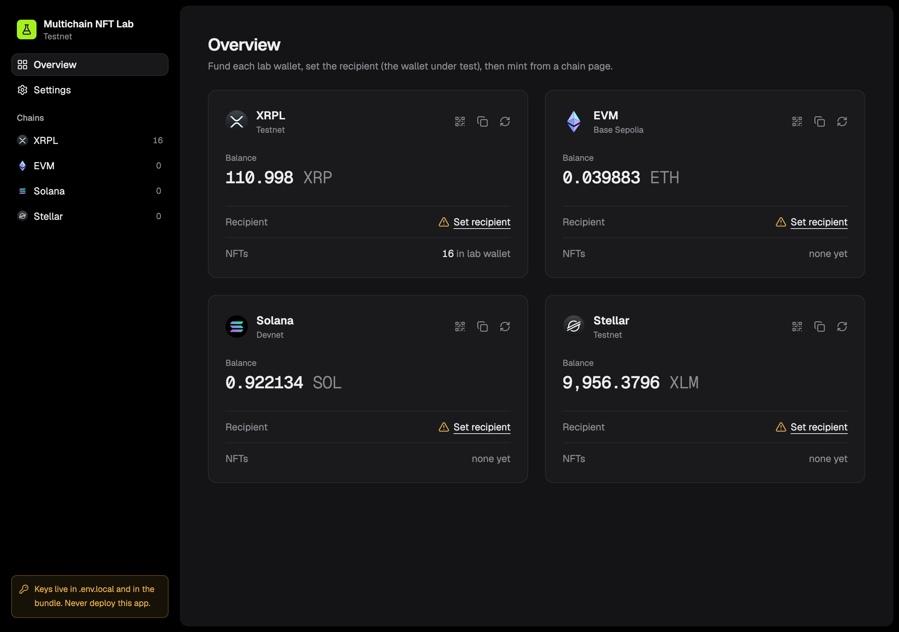

# Multichain NFT Lab

A local web app (and `scripts/nft.mjs` CLI) that mints test NFTs of 15 edge-case types on XRPL, EVM, Solana and Stellar/Soroban and sends them to a wallet under test.



**Warning:** the keys are in the bundle, so never deploy this. Mainnet mode spends real funds (see [Mainnet](#mainnet)).

## Setup

Needs Node 22.18 or newer (`nvm install` reads `.nvmrc`). Python 3 only for `npm run samples`, Docker only for `npm run build:soroban`.

```
npm install
npm run wallets   # writes throwaway testnet keys to .env.local and prints the addresses
npm run dev       # http://127.0.0.1:5174
npm test
```

`npm run wallets` prints the four lab wallets plus an XRPL "spare" address: leave the spare unfunded, it is the destination for a negative test. It refuses to overwrite an existing `.env.local`. Keys stay local: `*.local` is gitignored.

## First run

1. **Fund the four lab wallets.** Each Overview card has the address (copy or QR). Testnet faucets:
   - XRPL: [XRP faucets](https://xrpl.org/resources/xrp-faucets) (Testnet). Recommended 5 XRP or more.
   - EVM: Base Sepolia by default, from any faucet in [Base's faucet list](https://docs.base.org/base-chain/tools/network-faucets). Recommended 0.001 ETH or more. The EVM page can switch to Ethereum Sepolia, which needs Sepolia ETH on the same address.
   - Solana (Devnet): [faucet.solana.com](https://faucet.solana.com). Recommended 0.1 SOL or more.
   - Stellar (Testnet): Friendbot, `https://friendbot.stellar.org/?addr=<your G… address>`. Recommended 20 XLM or more.
2. **Set the recipient** per chain: the wallet you are testing. "Set recipient" on Overview or the pencil on a chain page.
3. **Mint** from a chain page: pick a type, a sample image and a destination, or "Mint all" to the recipient. EVM and Soroban contracts are deployed on the first mint (or from the Contracts tab). On XRPL, minting to the recipient creates a sell offer: accept it in the wallet under test.

## NFT images and metadata

They must be public: wallets fetch them themselves. By default the six samples load from this repo, `github.com/mikekoro/multichain-nft-playground` (raw.githubusercontent.com), so that repo has to be public.

- **Your own image:** host the image and its metadata JSON anywhere public (or `ipfs://`), then paste the JSON URL into the Mint card (CLI: `--uri`).
- **Move the samples** (for example in a fork):
  1. `npm run samples -- https://raw.githubusercontent.com/<you>/<repo>/main/public/samples` (rewrites `public/samples/*.json` to that URL)
  2. Upload `public/samples/` there (for a GitHub fork: commit and push).
  3. Paste the same URL into Settings, Sample base URL.

## CLI

The same chain code without a browser, one JSON line per command:

```
node scripts/nft.mjs addresses
node scripts/nft.mjs types
node scripts/nft.mjs mint xrpl.transferable --to self --sample 2
```

`--sample` is 1-6, like the sample tiles, and always uses the default sample base (pass `--uri` for moved samples). `--to <address>` also saves that address as the chain's recipient. The CLI keeps its own state in `.testnet-state.local` (`.mainnet-state.local` with `--mainnet`): contracts, mint log and recipients, separate from the browser: its first EVM or Soroban mint deploys its own contracts, and its mints don't appear in the app's mint log. All commands are listed at the top of `scripts/nft.mjs`.

## Configuration and troubleshooting

RPC endpoints are public defaults in `.env`; override any of them in `.env.local`. If a balance shows "connect() timed out" or another RPC error, the public endpoint is down or slow: point that chain at another provider.

Compressed Solana NFTs need a DAS-capable RPC (e.g. Helius) in `VITE_SOLANA_DAS_RPC`; without it they can't be read or sent.

The Soroban contract ships prebuilt as `public/playground_nft.wasm`; `npm run build:soroban` rebuilds it (Docker).

## Mainnet

`npm run dev:mainnet` (or `VITE_NETWORK=mainnet` in `.env.local`; CLI: `--mainnet`) switches every chain to mainnet with real funds: XRPL mainnet, Arbitrum, Solana mainnet and Stellar pubnet, using the same keys. There are no faucets. Each endpoint has a `_MAINNET` twin in `.env`; the public Solana mainnet RPC refuses browsers, so set `VITE_SOLANA_RPC_MAINNET` (and `VITE_SOLANA_DAS_RPC_MAINNET` for compressed NFTs) to a provider such as Helius. Mainnet contracts, mint log and recipients are stored separately from testnet.

MIT, see [LICENSE](LICENSE). Uses OpenZeppelin Contracts and Stellar Contracts (MIT) and soroban-sdk (Apache-2.0).
